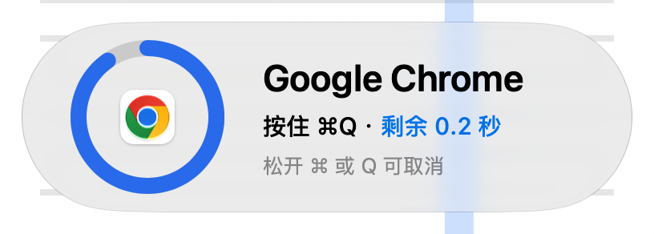
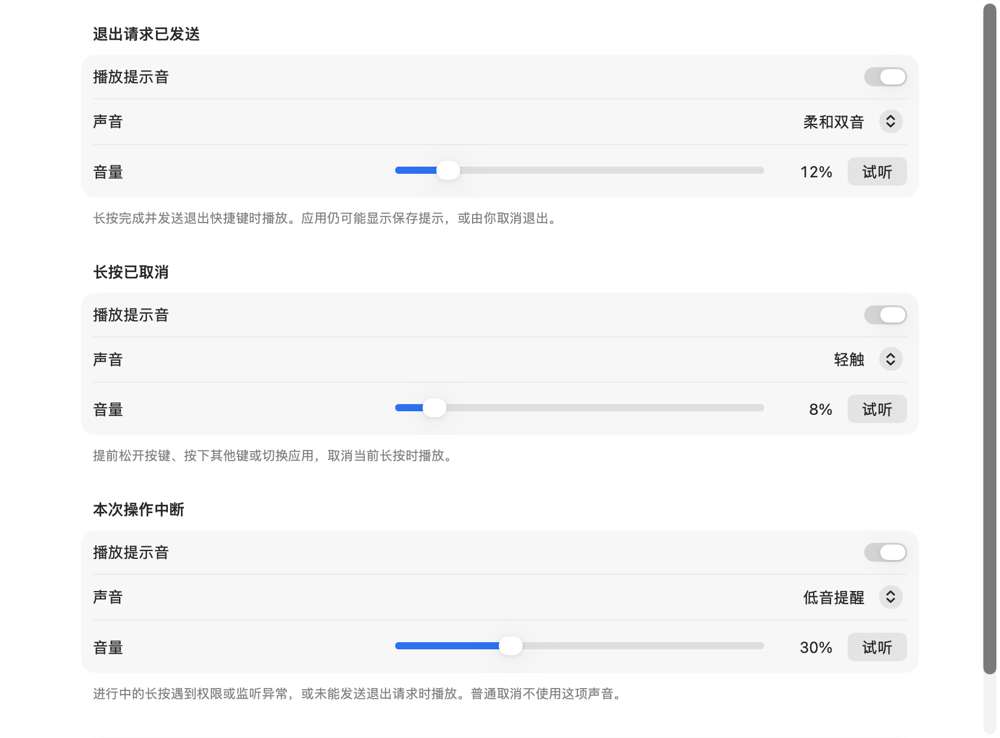

# SlowQuitGuard

当前版本：0.4.0。

Swift 原生菜单栏工具。短按 ⌘Q 会取消退出，按住至进度完成后向原目标应用发送一次退出请求。默认按住 1 秒，可调整为 0.5–3 秒。

菜单栏的盾牌图标用于查看状态、选择要保护的应用和打开设置。工具手动启动，不显示 Dock 图标。

本项目参考 [SlowQuitApps](https://github.com/dteoh/SlowQuitApps) 的源码与交互设计，以 Swift 重写。感谢原作者 [Douglas Teoh](https://github.com/dteoh) 和上游贡献者；本项目保留上游署名，沿用 GPL v2 或更高版本。详见[来源与致谢](#来源与致谢)。

## 只想关一个标签页，却误退出了整个浏览器

在 Safari 浏览网页时，本来只是想按 **Command+W（⌘W）关闭当前标签页**，却误触旁边的 **Command+Q（⌘Q）**，整个浏览器退出，打开的窗口和标签页一下都从眼前消失。这种误触会打断正在进行的阅读和工作。

SlowQuitGuard 为退出快捷键加上一段长按时间：**误触、短按 ⌘Q 会被拦下；确实想退出时，再按住 ⌘Q 至圆环完成。** 默认只需按住 1 秒，⌘W 仍按 Safari 原来的方式关闭标签页。

这也适用于其他需要防误退出的应用。先完成授权，并确认目标应用已启用保护；你可以在应用名单中单独调整。

## 界面截图

以下为原生界面实际截图，使用演示应用和默认设置。浮岛的材质会随系统版本、深浅色外观和当前窗口背景变化。

**长按退出浮岛**：显示目标应用、连续圆环进度和剩余时间。



**声音设置**：分别配置退出请求、长按取消和操作中断的提示音、音量与试听。



## 打开和授权

1. 将 App 放到准备长期使用的位置，例如“应用程序”，再打开。
2. 缺少权限时，引导窗口会出现。每一行都有自己的状态和“打开设置…”按钮，点击要处理的那一行，按系统页面提示打开 **SlowQuitGuard** 的开关。
3. 引导显示期间，每 0.6 秒重新读取系统权限；检测到授权后会自动检查并请求下一项。系统已经允许的项目直接通过，不会要求重复授权。
4. 如果界面还没有前进，点“我已授权，重新检查”。只有系统检查通过才会前进；尚未通过时会明确提示。全部通过后点“完成”，再查看菜单栏连接状态。

| 检查项 | 对应系统页面 | 用途 |
| --- | --- | --- |
| 拦截退出快捷键 | macOS 27：“设备控制和数据访问”；较早版本：“辅助功能” | 拦截其他应用中的 ⌘Q |
| 发送退出快捷键 | 与上一项共用设置页，单独检查发送是否被允许 | 长按完成后向目标应用发送正常退出请求 |
| 输入监控 | “输入监控”，有独立的打开设置按钮 | 键盘连接需要时授权 |

三项始终可见。已经允许的项目仍能打开自己的设置；输入监控未授权且当前连接不需要它时，显示“未授权”和“当前连接无需授权”，不会因此阻止完成。手动点击该项的按钮会请求它并打开输入监控页面，便于在系统列表中配置本工具。

“暂不授权”和窗口关闭按钮会关闭引导，工具仍留在菜单栏。再次打开 App，若权限仍不齐，会再次显示引导。自动流程在每次运行中对每项权限最多请求一次，避免反复弹窗；你仍可主动打开系统设置。

“启用防误触保护”是总开关。关闭时所有应用都暂停保护，应用名单和名单模式会保留。

通常先处理“设备控制和数据访问”（旧系统称“辅助功能”）。发送退出快捷键单独检查，不能仅凭第一项通过就认定发送也通过。输入监控只在连接需要时自动请求，不需要时可保留未授权。

如果系统中的开关已打开，但“发送退出快捷键”仍未通过，先退出并重新打开当前这份 App，再检查。系统要求重新打开 App 时，也按系统提示完成。

更新构建、移动 App 或系统更改权限后，如果仍提示未授权，请在对应权限列表核对当前这份 App，必要时移除旧条目再添加。此包使用本地 ad-hoc 签名，没有使用开发者证书或 Apple 公证；重新构建可能需要重新授权。先选定使用位置，再授权，有助于避免混用不同副本。

## Chrome 已有退出提醒时怎么设置

1. 在 Chrome 自己的菜单中确认退出提醒已开启，英文名称为 **Warn Before Quitting**。
2. 点击 SlowQuitGuard 的菜单栏图标，展开“正在运行的应用”。
3. **取消勾选 Google Chrome。**

取消勾选后，Chrome 按自己的设置处理 ⌘Q。本工具不拦截，也不修改 Chrome 的退出设置。

如果 Chrome 未开启自己的退出提醒，而你希望由本工具保护它，请保持勾选。其他自带退出提醒的应用也可按同样方式选择。本工具不自动判断所有应用是否开启了自带提醒。

## 选择要保护的应用

| 位置 | 操作和含义 |
| --- | --- |
| “当前应用：名称”下面的勾选项 | 勾选“为此应用开启防误触保护”，或取消勾选以排除它 |
| “上一个应用：名称” | 自己的设置窗口位于前台时，显示最近使用的其他应用 |
| 菜单栏 → “正在运行的应用” | 快速勾选多个运行中的应用；选择会保存 |
| 菜单栏 → “应用保护设置…” | 打开双栏名单管理，添加尚未运行的应用、移动名单项或切换名单模式 |

**勾选**：使用本工具的长按 ⌘Q 保护。**取消勾选**：交给应用原来的退出功能。排除不会替该应用开启退出提醒。

运行列表只放在菜单栏中，显示具有普通界面的应用，不列出后台助手、Finder 和 SlowQuitGuard。退出应用不会清除选择。

设置中的“应用保护”有两栏：**已保护应用**和**已排除应用**。各栏的“添加应用…”可从磁盘选择一个或多个 App，不要求它们正在运行。行末箭头把应用移到另一栏；“×”移出名单，之后按名单模式的默认规则处理。同名应用会显示各自的标识，方便区分。

| 名单模式 | 已保护应用 | 已排除应用 | 未列出的应用 |
| --- | --- | --- | --- |
| 默认保护（黑名单） | 长按保护 | 原来的退出方式 | 长按保护 |
| 仅保护所选（白名单） | 长按保护 | 原来的退出方式 | 原来的退出方式 |

初始模式是“默认保护（黑名单）”，保留已有的排除选择。此模式下，“已保护应用”列出你明确加入的应用；未列出的应用同样受保护。切换模式会保留两栏名单。白名单为空时，不会保护任何应用，菜单会提醒添加。

## 长按退出

- 短按 ⌘Q：取消退出。
- 按住 ⌘Q：显示玻璃浮岛，左侧粗圆环连续填充，右侧完整显示应用名和剩余时间。较长应用名会换行。
- 到期后：圆环填满并显示绿色勾号和“已发送退出请求”，短暂停留后收起。
- 提前松开 ⌘ 或 Q、按下其他键、切换应用：取消本次长按。
- “启用防误触保护”：暂停或恢复整个工具；暂停期间 ⌘Q 按原方式工作。
- “修复保护”：当 ⌘Q 表现异常时，取消本次长按，重新检查权限，再连接一次键盘监听。它不改变应用名单或名单模式。正常使用时无需点击。

Finder 和 SlowQuitGuard 自己不进入保护。⌃⌘Q、带 Shift/Option/Fn 的其他组合及 ⌘Tab 期间的 Q 保持系统用途。菜单退出、Dock 退出、强制退出不属于此工具的保护范围。

应用自己的保存提示或退出确认仍可能出现。工具不会强制结束进程。

浮岛不接管键盘焦点，也不接收鼠标点击。macOS 26 及以后使用系统 Liquid Glass；较早版本使用原生材质。开启系统“减少透明度”时使用实色表面，开启“减少动态效果”时取消退出过渡动画。

## 提示音

在“设置 → 声音”中，各类提示可以**分别开关、选择声音、调整 0–100% 音量和试听**。选择和音量会保存；调整滑块本身不会播放声音。“试听”是主动播放，不受该项自动提示开关限制，音量为 0 时不播放。

| 提示 | 何时播放 | 默认声音与音量 |
| --- | --- | --- |
| 退出请求已发送 | 长按完成，向目标应用发送了退出快捷键 | 柔和双音，12% |
| 长按已取消 | 提前松开、按下其他键、切换应用，取消正在进行的长按 | 轻触，8% |
| 本次操作中断 | 长按过程中出现权限或监听异常，或未能发送退出请求 | 低音提醒，30% |

三种声音均为短音，不循环。音量只控制本工具，不改变系统音量；最终响度也受系统音量及输出设备影响。成功和取消默认较轻，中断提醒更明显。后台连接检查和自动重试不播放声音，重复通知不会重复播放同一次长按的提示。

“退出请求已发送”表示本工具已发出快捷键，不表示目标应用已经关闭。目标应用之后显示的保存提示、确认或取消，不会被当作本工具的失败。权限完全不可用时，本工具可能无法观察按键，声音也不能替代保护状态提示。

## 状态提示

| 状态 | 含义 |
| --- | --- |
| 防误触保护已开启 | 权限检查通过，键盘过滤器已启用 |
| 需要设备控制和数据访问授权（旧系统：需要辅助功能授权） / 退出按键发送待授权 | 当前无法完成拦截或发送退出快捷键 |
| 安全输入期间暂停 | macOS 正在限制键盘监听，状态结束后自动检查恢复 |
| 当前会话已暂停 | 睡眠、屏幕睡眠或会话切换期间暂停 |
| 正在恢复保护 / 保护尚未连接 | 监听已中断或连接失败，正在自动重试 |
| 请添加已保护应用 | 当前使用白名单模式，但还没有选中要保护的应用 |
| 已手动暂停 | 用户关闭了保护开关 |

安全输入是系统提供的输入保护机制。工具只观察其全局启用状态，不关闭该机制，也不识别是哪个应用开启了它。仅离开某个窗口不一定会结束安全输入。

监听停用通知和每秒健康检查共同负责恢复。失败重试逐步退避至最多每 30 秒一次；监听连续稳定 10 秒后重置退避。权限恢复、睡眠唤醒和点击“修复保护”也会重新检查。在任何中断中，正在进行的长按会取消，恢复后须重新按键。

## 构建和测试

需要 macOS 14 或更高版本，以及包含 Swift 6 的 Xcode。工程不依赖第三方包。

在仓库根目录运行：

```bash
./script/test.sh
./script/build_and_run.sh --build-only --release --staged
```

App 和 ZIP 输出到 `dist/versions/0.4.0/`。将 `SlowQuitGuard.app` 放到准备长期使用的位置，再打开并按上面的步骤授权。构建脚本使用本地 ad-hoc 签名，没有使用 Developer ID 证书或 Apple 公证。重新构建或移动 App 后，系统可能要求重新授权。

日常开发可运行 `./script/build_and_run.sh` 编译并打开 App。`--build-only` 只构建；`--logs` 查看进程日志；`--telemetry` 查看本机保护状态日志；`--debug` 使用 LLDB。`--verify` 只检查进程是否出现。

提示音资源可通过 `python3 script/generate_feedback_sounds.py` 重新生成。该脚本生成短正弦音，不播放声音，也不改变系统音量。

工程最低目标为 macOS 14。自动化测试覆盖长按状态机、应用规则、恢复退避、权限流程、提示音路由与独立 UI；它们不验证真实跨应用按键拦截或实际音频听感。macOS 14 至 26 和 Intel 的实际运行兼容性仍待验证。

手动检查时，请使用没有重要未保存内容的窗口，检查短按取消、长按退出、提前松开、长按中切换应用、排除应用、安全输入、睡眠唤醒，以及应用自己的保存确认。

## 隐私与本机数据

应用仅在本机工作，没有网络请求，不需要账号或 API Key，也不上传遥测数据。键盘监听用于识别退出快捷键与取消条件，不保存一般键盘输入内容。

保护开关、长按时间、应用名单和提示音设置保存在本机偏好设置中；名单包含应用名称、标识及本机路径。诊断日志只记录保护状态变化和退出快捷键已发送的事件，不记录浏览器标签页、网页内容或一般按键。

App 的偏好域与日志子系统为 `org.slowquitguard.SlowQuitGuard`。所需的系统权限及用途见上面的[打开和授权](#打开和授权)。

## 来源与致谢

SlowQuitGuard 参考并以 Swift 重写了 [dteoh/SlowQuitApps](https://github.com/dteoh/SlowQuitApps)，延续其通过全局长按 ⌘Q 防止误退出的设计。感谢原作者 **Douglas Teoh** 和所有上游贡献者公开源码，使本项目得以在其基础上学习和改进。

参考的上游版本为提交 [`2c75877`](https://github.com/dteoh/SlowQuitApps/commit/2c75877c633f5918bdca20e3b3046318632e0d80)。上游版权声明为 `Copyright (C) 2020 Douglas Teoh`，许可为 GNU GPL v2 或更高版本。完整来源及版权说明见 [NOTICE](NOTICE)。相关核心源码也保留了来源说明。

本项目的应用图标由 `script/generate_icon.swift` 生成。

## 许可

本项目沿用上游的 **GNU GPL v2 或更高版本（GPL-2.0-or-later）**。完整条款见 [LICENSE](LICENSE)，版权及来源说明见 [NOTICE](NOTICE)。软件不提供担保。欢迎在遵守许可证、保留版权与来源说明的前提下使用、研究、修改和再分发。
